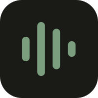
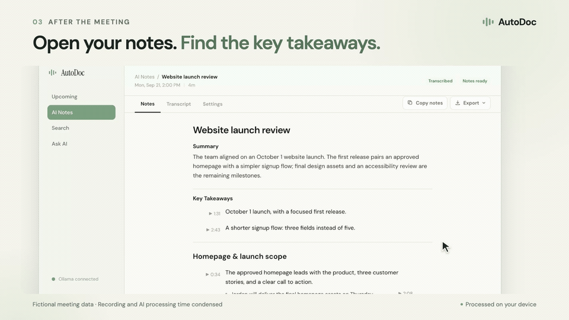
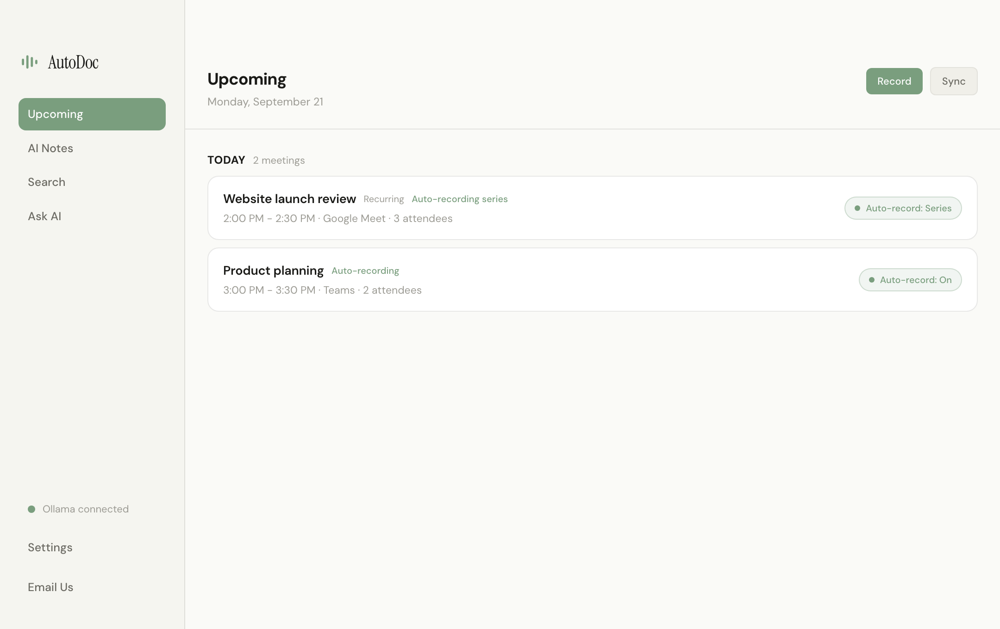
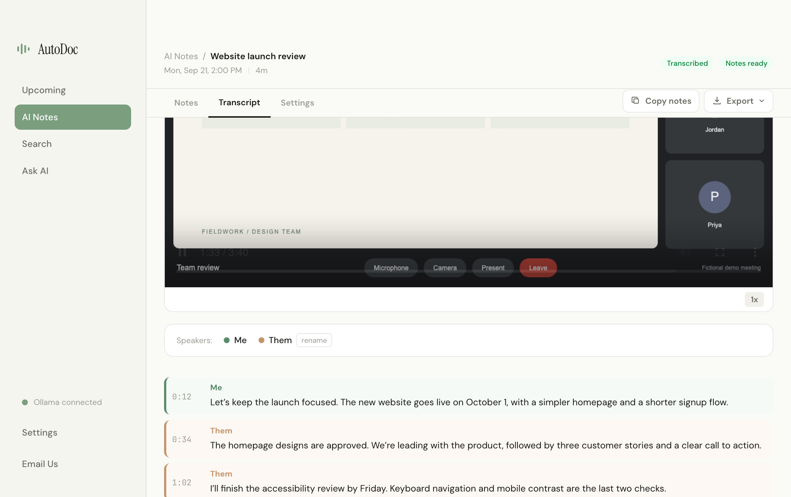
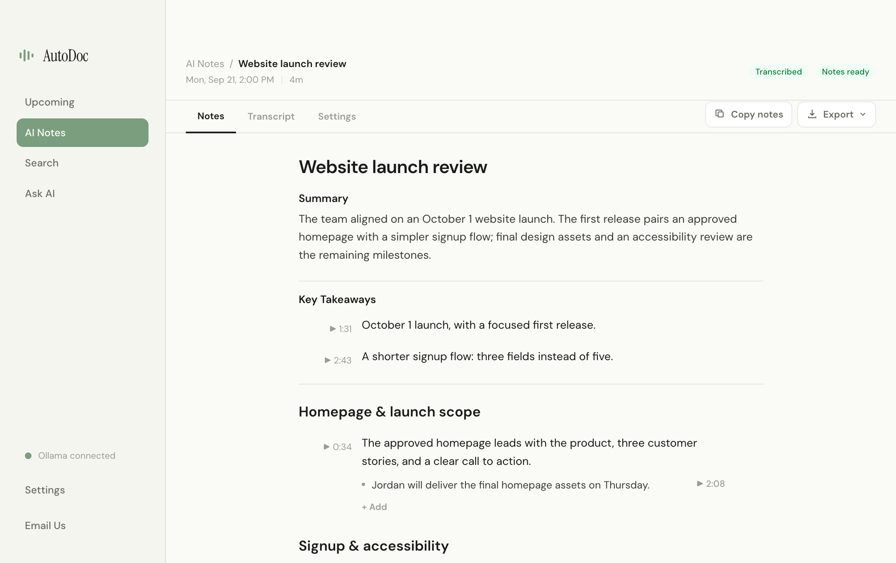
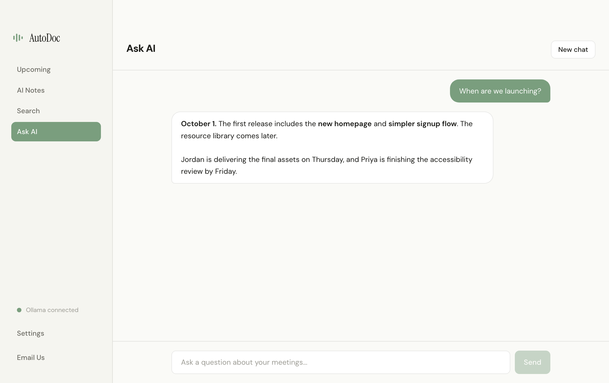
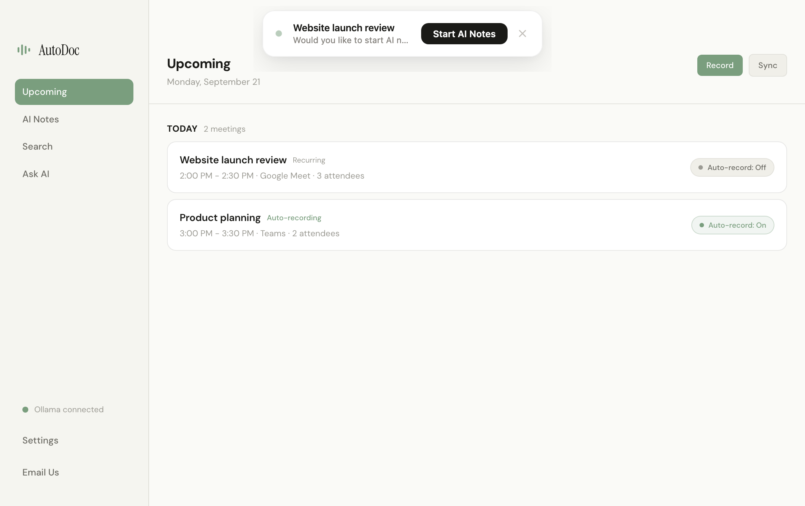
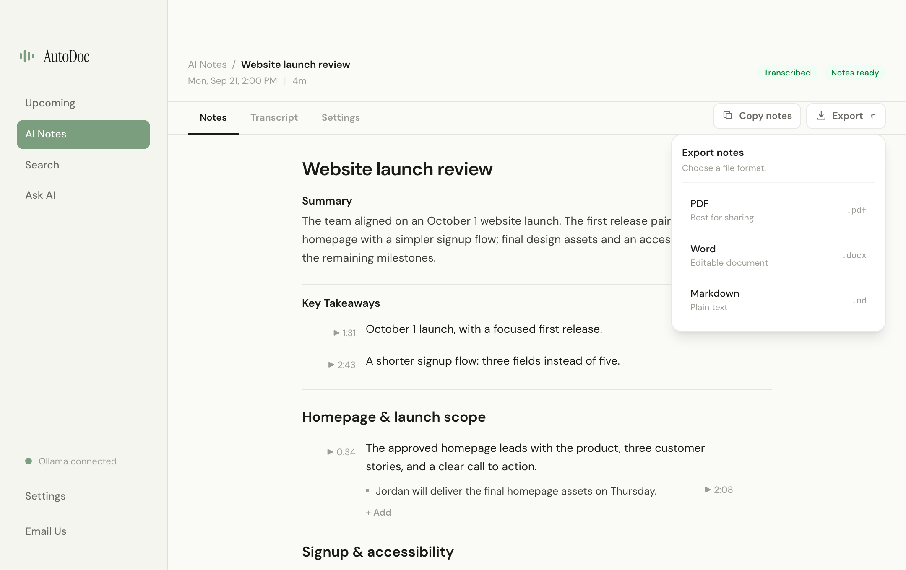
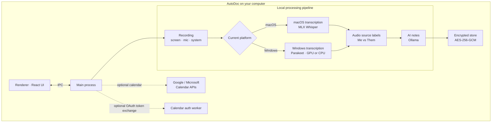

<div align="center">



# AutoDoc

### Open-source meeting notes for Mac and Windows that also record your screen, so you can click a note and replay that moment.

AutoDoc is an open-source, local-first meeting notes app for macOS and Windows. Record your screen and meeting audio, get editable notes, and click a note's timestamp to replay the moment. Transcription, notes, and Ask AI run on your computer. No AutoDoc account or AI API key required.

[](https://github.com/DuetDisplay/AutoDoc/releases/latest) [](https://github.com/DuetDisplay/AutoDoc/releases/latest)

[](LICENSE) [](PRIVACY.md) [](#download) [](https://github.com/DuetDisplay/AutoDoc/releases/latest)

</div>

---

<div align="center">



<!-- latest-release:start -->

**New in v1.3.2:** This release updates AutoDoc’s underlying runtime and networking components with security fixes for macOS and Windows. [Read the latest release notes](https://github.com/DuetDisplay/AutoDoc/releases/latest).

<!-- latest-release:end -->

</div>

---

## Features

AutoDoc keeps the whole meeting workflow on your computer, from detection to replay, and every feature below is included, not a paid upgrade.

- **On-device transcription.** Models are chosen for your meeting language and hardware, with no network round-trips for your audio.
- **Local notes, no accounts.** Notes run through a local [Ollama](https://ollama.com) instance AutoDoc manages. No AutoDoc account, no API keys, no inference bills.
- **Multi-track capture.** Screen, microphone, and system audio are recorded as separate streams. Your microphone is labeled Me and combined system audio is labeled Them; AutoDoc does not identify individual remote participants.
- **Replay key moments.** Watch the recording in the Transcript tab, or click a note's timestamp to jump to that moment in the video.
- **Editable notes.** Get a summary and conversation topics with supporting details, edit them, copy as plain text, or export to PDF, Word, or Markdown. Review generated notes before relying on them.
- **Ask AI across meetings.** Get grounded answers drawn from your meetings, entirely on-device.
- **Calendars and detection.** Connect Google and Microsoft calendars with Off / Once / Series auto-record per event. AutoDoc lives in your macOS menu bar or Windows tray and offers to record when a Zoom, Meet, Teams, Webex, or Slack meeting starts.
- **Full-text search.** Search every transcript and note, with deep links straight to the moment.
- **27 meeting languages** on supported hardware. See [System requirements](#system-requirements) for what each machine supports.
- **Encrypted at rest.** AES-256-GCM protects recordings, transcripts, notes, and metadata. Electron `safeStorage` protects the key through macOS Keychain or Windows DPAPI when available; otherwise the key is stored locally without operating-system protection. Exported files are separate from this encrypted storage.

See [`PRODUCT.md`](PRODUCT.md) for a deep technical breakdown of every subsystem.

## Features in action

| Calendar auto-recording | Video and timestamped transcript |
|---|---|
|  |  |

| Notes with a summary, topics, and details | Ask AI across meetings |
|---|---|
|  |  |

| Automatic meeting detection | Copy and export |
|---|---|
|  |  |

## Download

> **Platform support:** AutoDoc supports **macOS 14+ on Apple Silicon** and **Windows 10+ on x64 PCs**. Intel Macs and Windows on ARM are not currently supported.

Ready-to-use installers are available for Mac and Windows. You do not need to build from source.

### macOS

1. On the [latest release](https://github.com/DuetDisplay/AutoDoc/releases/latest), download the macOS `.dmg` asset.
2. **Open** the `.dmg` and drag **AutoDoc** into your **Applications** folder.
3. **Launch** AutoDoc from Applications. On first run it walks you through granting **Screen Recording** and **Microphone** permissions; macOS verifies **System Audio Capture** separately when recording starts. AutoDoc then downloads its local transcription and AI models (~10 GB, one time).

### Windows

1. On the [latest release](https://github.com/DuetDisplay/AutoDoc/releases/latest), download the Windows `.exe` installer asset.
2. **Open** the installer and follow the setup prompts.
3. **Launch** AutoDoc. On first run it walks you through capture permissions and downloads the local transcription and Ollama models for your selected meeting language.

That's it — no account, no API keys, nothing to configure. Meeting processing runs locally from here on.

### System requirements

Local-first meeting apps need real hardware headroom. AutoDoc adjusts its processing profile to the available hardware while keeping meeting content on your device.

| | macOS | Windows |
|---|---|---|
| **OS version** | macOS 14.0 (Sonoma) or later | Windows 10 or later, 64-bit |
| **Processor / chip** | **Apple Silicon required** (M1, M2, M3, M4, or later) | x64 Intel or AMD; **8+ logical processors** recommended for CPU-only processing |
| **Memory** | **8 GB minimum** (supported) · **16 GB+ recommended** | **8 GB minimum** (supported) · **16 GB+ recommended** |
| **GPU** | Built into Apple Silicon; nothing extra needed | Optional. A DirectML GPU with **4 GB+ VRAM** accelerates Parakeet transcription; CPU fallback is automatic |
| **Storage** | **~10 GB free** for first-run downloads, plus space for encrypted recordings | **~10 GB free** for first-run downloads, plus space for encrypted recordings |
| **Network** | Needed for the first-run model download; offline afterwards for recording, transcription, and notes | Needed for the first-run model download; offline afterwards for recording, transcription, and notes |
| **Permissions** | **Screen Recording**, **Microphone**, **System Audio Capture** | **Screen capture**, **Microphone**, **System Audio** |

Transcription on Mac is built on [MLX](https://github.com/ml-explore/mlx) and requires Apple Silicon; there is no Intel or Rosetta fallback.

**Lower-spec computers.** 8 GB Macs and 8 GB Windows PCs (including ones with a GPU) are English-only and use the smaller `llama3.2:3b` notes model with sequential audio processing and notes after transcription, so expect a longer wait after the meeting. Windows CPU-only machines with fewer than 8 logical processors or under 16 GB of RAM get the same English-only, lower-impact profile. A GPU does not replace RAM headroom. Settings shows which languages are available on your computer, and the [meeting language list](https://getautodoc.com/faq#languages) covers language-specific requirements.

## Build from source

AutoDoc is an Electron + electron-vite app. To build it yourself:

**Prerequisites**

- **macOS:** Apple Silicon Mac (M1 or later) running macOS 14+, plus Xcode command-line tools and [Homebrew](https://brew.sh)
- **Windows:** Windows 10+ on x64, plus the prerequisites documented by the setup scripts
- Node.js 20+

**Steps**

```bash
git clone https://github.com/DuetDisplay/AutoDoc.git
cd AutoDoc
npm ci
cp .env.example .env   # optional: configure self-hosting knobs
npm run build:mac      # macOS: produces a DMG under dist/
# or
npm run build:win      # Windows: produces an installer under dist/
```

To run in development:

```bash
npm run dev
```

If you want calendar integration or your own hosted services in a fork build, see [`docs/SELF_HOSTING.md`](docs/SELF_HOSTING.md) for the required environment variables and OAuth setup. Forks do **not** use Duet's hosted infrastructure by default.

## Under the hood

AutoDoc is a single Electron app. The **main process** owns recording, the transcription and summarization pipeline, encryption, calendar sync, and the local Ollama lifecycle. The **renderer** is a React UI. All heavy processing happens locally.

| | macOS (Apple Silicon) | Windows |
|---|---|---|
| **English transcription** | MLX Whisper `distil-large-v3` | Parakeet TDT 0.6B v3, DirectML GPU or CPU-optimized |
| **Other languages** | Canary or Whisper large-v3-turbo | Canary or Whisper large-v3-turbo |
| **Notes and Ask AI answers** | `qwen3:4b-instruct` by default; `llama3.2:3b` on lower-spec machines | `qwen3:4b-instruct` by default; `llama3.2:3b` on lower-spec machines |
| **Ask AI search embeddings** | `qwen3-embedding:0.6b` | `qwen3-embedding:0.6b` |

<details>
<summary>Architecture diagram</summary>



</details>

## Privacy

AutoDoc processes meeting content on-device. Audio, transcripts, and notes are not uploaded to AutoDoc or a cloud AI API. Analytics and crash reporting are strictly **opt-in**; before opt-in, analytics facts stay local only. Read the full [**Privacy Policy**](PRIVACY.md) for exactly what is and isn't collected, and [`PRODUCT.md`](PRODUCT.md) for the technical details.

**When AutoDoc uses the network**

- Required once: the first-run download of local transcription and Ollama models.
- Optional: app updates and additional model downloads. Official public updates can use a Cloudflare mirror with daily aggregate request totals; see [`docs/UPDATE_MIRROR.md`](docs/UPDATE_MIRROR.md).
- Optional Google/Microsoft calendar sync, where the app talks directly to their APIs. Duet's stateless OAuth worker only exchanges tokens and never receives recordings, transcripts, or notes.
- Optional analytics and crash reporting, only if you opt in.

## FAQ

**Is AutoDoc a Granola alternative?**
Yes — a free, open-source one that processes meetings on your computer and keeps a screen recording you can replay. See [how AutoDoc compares](https://getautodoc.com/granola-alternative).

**How do I know AutoDoc is recording?**
While recording, AutoDoc shows a Recording banner in the app (with a timer and stop control) and switches the menu bar / tray icon to a recording state. Meeting detection only offers to start recording; it will not start silently unless you previously enabled calendar auto-record for that event (Once or Series). In that case, recording can begin without another prompt.

**What about other participants?**
AutoDoc records on your computer. It does not join the call as a bot or announce itself to others. You are responsible for following the recording laws and norms that apply to your meeting.

**Does AutoDoc include action items in its notes?**
Action items are currently omitted from generated notes while Next Steps is disabled. Information classified as an action item can also be omitted. Review the recording and transcript when checking follow-up commitments. See the [latest release notes](https://github.com/DuetDisplay/AutoDoc/releases/latest) for known issues.

**Will my existing notes change after updating?**
Updating does not automatically regenerate your existing meeting notes. You can reprocess a meeting when you want to generate new notes. Older notes remain supported.

## Contributing

Contributions are welcome! Please read [`CONTRIBUTING.md`](CONTRIBUTING.md), the [`ROADMAP.md`](ROADMAP.md), and our [`CODE_OF_CONDUCT.md`](CODE_OF_CONDUCT.md) before opening a pull request. Security issues should follow the process in [`SECURITY.md`](SECURITY.md).

## License

AutoDoc is licensed under the **GNU Affero General Public License v3.0** ([`LICENSE`](LICENSE)). You're free to use, study, modify, and share it, and if you run a modified version as a network service you must make your source available to its users under the same license.

## Acknowledgements

AutoDoc stands on the shoulders of excellent open-source work:

- [whisper.cpp](https://github.com/ggerganov/whisper.cpp) — on-device speech-to-text
- [NVIDIA NeMo Parakeet](https://huggingface.co/nvidia/parakeet-tdt-0.6b-v3) — Windows speech-to-text
- [ONNX Runtime](https://onnxruntime.ai/) and [DirectML](https://github.com/microsoft/DirectML) — Windows inference
- [faster-whisper](https://github.com/SYSTRAN/faster-whisper) and [CTranslate2](https://github.com/OpenNMT/CTranslate2) — compatibility transcription
- [Ollama](https://ollama.com) — local LLM runtime
- [Apple MLX](https://github.com/ml-explore/mlx) — Apple Silicon acceleration
- [FFmpeg](https://ffmpeg.org) — audio/video processing
- [Electron](https://www.electronjs.org) + [electron-vite](https://electron-vite.org) — desktop app foundation

---

<div align="center">
Made by <a href="https://getautodoc.com/">Duet Display, Inc.</a>
</div>
